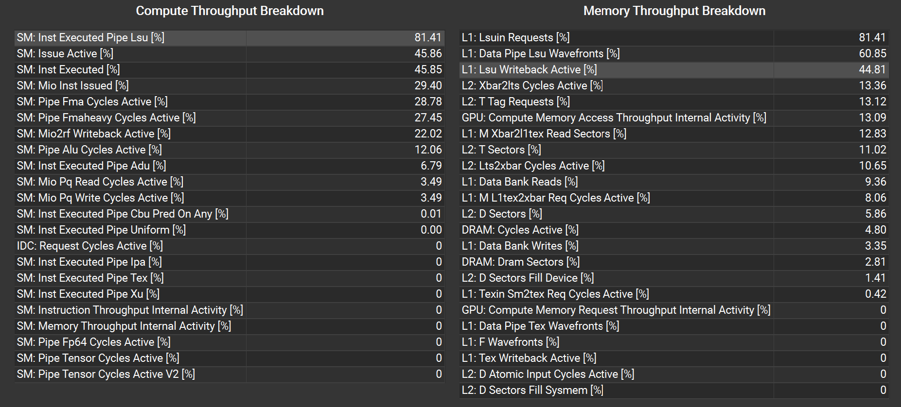
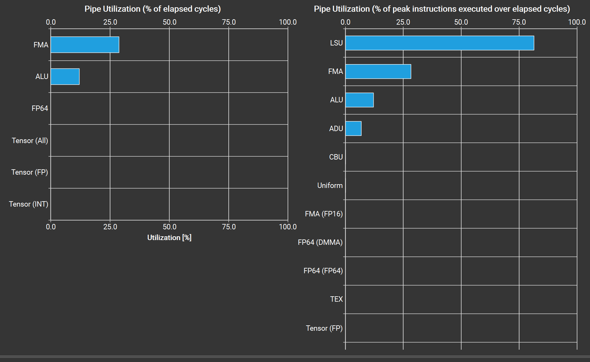

# v0

中间版本 v0.1  
最终版本 v0.2

### 分析
Waves Per SM	2.67
Achieved Occupancy [%]	16.67
Block Limit Registers [block]	1
Registers Per Thread [register/thread]	129

每个SM：
每线程使用的寄存器数 * 对齐后每线程块的线程数 * SM中线程块数 <= 65536
故
Block Limit Registers <= 256 / 每线程使用的寄存器数
每线程使用的寄存器数量过多


### 调整
针对(M, N, K)为1024，1024，1024的情况，将BM、BN、BK降低至原先的50%并针对性修改代码，以降低每线程寄存器数

### 分析
Waves Per SM	2.67
Achieved Occupancy [%]	59.56
Registers Per Thread [register/thread]	56
此时工作强度足够大，进入下一步

Compute (SM) Throughput [%]	81.41
Memory Throughput [%]	81.41
可能接近硬件极限，然而：
Memory Throughput [%]	81.45
且
DRAM Throughput [%]	4.80
本项目单卡运行设备代码，无peer内存，故流量*可能*聚集在了system momory中，导致带宽降低

pcie__read_bytes.avg.per_second [Mbyte/s],3.00
pcie__write_bytes.avg.per_second [Mbyte/s],14.23
但
L1/TEX Total 对应的 Sector Misses to System 、 Sector Misses to Peer 均为零
由于
nsys-rep文件中表明被nvtx标记的周期内，无pcie写指令和读指令
故出现的pcie流量实际上源于分析范围以外。

接下来分析特定的计算管线或具体层次的内存对应的指标
注意到：

L1/TEX Cache的活跃度极高，与其他指标拉开明显差距

GEMM算子理论上会大量占用的FMA管线和ALU管线，但ta们的指标仅为LSU的三分之一
表明*L1/TEX为瓶颈*，原因可能是指令过于繁琐，对应代码中对SMEM的访问部分

### 调整
数据先向量化再传输，减少指令数
1. float4向量化
2. 解耦load As、Bs模块

### 分析
调整后kernel绝对运行时间从682784 ns减慢至759872 ns
注意到
smsp_average_barrier 7.270014565377191
对应Warp State (All Cycles)图中的 Stall barrier，其值为7.27，联想到代码中：`if (K % 4 == 0 && a_thread_y < BM)`，表明由于**严重的warp divergence**，导致stall barrier断档式颇高

### 调整
设定BM = 128 BN = 128 BK = 8，保证load As或Bs时CTA中的每个线程均参与传输；同时避免使用分支，导致大量warps空闲


绝对运行时间：
v0  682784 ns
v0.2  516704 ns
增幅约 24.32%

```
namespace {

    __device__ float4& FLOAT4(float& f) {

        return reinterpret_cast<float4&>(f);
    }

    __device__ const float4& CONST_FLOAT4(const float& f) {

        return reinterpret_cast<const float4&>(f);
    }
}


// v0
// 协作加载 tileA: 全局内存 → Shared Memory
// r0 = blockIdx.y * BM,  k = 当前 K 维度起点
template <int BM, int BK, int BLOCK_SIZE>
__device__ void load_tile_A(const float *__restrict__ A, float As[BM][BK],
int M, int K, int r0, int k, int tid) {
    // 线程重排: 128 * 2 布局, 实现合并访问以及float4向量化 (coalesced access)
    constexpr int A_BLOCK_X = BK / 4;                     // = 2
    // constexpr int A_BLOCK_Y = BLOCK_SIZE / A_BLOCK_X; // = 128
    int a_thread_x = tid % A_BLOCK_X;                 // 0 ~ 1
    int a_thread_y = tid / A_BLOCK_X;                 // 0 ~ 127


    // float4向量化前：32 * 8个线程，每个线程做4次LDG.32，128 * 8个数据循环4次处理完成
    // float4向量化后：128 * 2个线程，每个线程做1次LDG.128，128 * 8个数据1次即可处理完成

    // 每个thread在grid中的索引
    int r = r0 + a_thread_y, c = k + a_thread_x * 4;

    // 计算线程块尺寸时应采用向上取整的除法，故存在线程数量大于数据总量的情况
    // 为确保LDG.128的16B对齐，K必须是4的倍数（最优情况下是 BK=8 的倍数）
    if (K % 4 == 0) {
        float4 temp = (r < M && c + 3 < K) ? CONST_FLOAT4(A[r * K + c]) : make_float4(0.f, 0.f, 0.f, 0.f); // LDG.128

        // 同一block内，具体一次K维度的循环中，所有thread的r0一定、k一定
        FLOAT4(As[a_thread_y][a_thread_x * 4]) = temp; // STS.128

        //warp32个线程中，每个线程处理一个float4类型，共512B；
        //硬件将其划分为4个128B内存事务，每个事务均占满SMEM的32个bank，流水线串行执行事务时无bank conflict
    }
    else {

        //r0用于A、C矩阵行索引，c0用于B、C矩阵列索引
        //A矩阵列索引、B矩阵行索引借助K-Loop中的循环变量k
        r = r0 + tid / BK;
        c = k + tid % BK;

        // 将tileA数据载入SMEM
        //同一block内，具体一次K维度的循环中，所有thread的r0一定、k一定。
        As[tid / BK][tid % BK] = (r < M && c < K) ? A[r * K + c] : 0.0f; //所有线程均运行该行代码，将HBM中的数据存入各自对应的block的SMEM
    }
}

// v0
// 协作加载 tileB: 全局内存 → Shared Memory
// c0 = blockIdx.x * BN,  k = 当前 K 维度起点
template <int BN, int BK, int BLOCK_SIZE>
__device__ void load_tile_B(const float *__restrict__ B, float Bs[BK][BN],
int K, int N, int c0, int k, int tid) {
    // 线程重排: 8×32 布局, 实现合并访问
    constexpr int B_BLOCK_X = BN / 4; // 128/4 == 32
    // constexpr int B_BLOCK_Y = BLOCK_SIZE / B_BLOCK_X; // = 8
    int b_thread_x = tid % B_BLOCK_X;                 // 0 ~ 31
    int b_thread_y = tid / B_BLOCK_X;                 // 0 ~ 7

    // float4向量化前：8 * 32个线程，每个线程做4次LDG.32，8 * 128个数据循环4次处理完成
    // float4向量化后：8 * 32个线程，每个线程做1次LDG.128，8 * 128个数据1次即可处理完成

    // 每个thread在block中的索引
    int r = k + b_thread_y, c = c0 + b_thread_x * 4;

    if (N % 4 == 0) {
        // 计算线程块尺寸时应采用向上取整的除法，故存在线程数量大于数据总量的情况
        // 为确保LDG.128的16B对齐，N必须是4的倍数（最优情况下是 BN=128 的倍数）
        // c0 = bx * BN，故c一定为4的倍数，不存在数据丢失情况
        float4 temp = (r < K && c + 3 < N) ? CONST_FLOAT4(B[r * N + c]) : make_float4(0.f, 0.f, 0.f, 0.f); // LDG.128

        // 同一block内，具体一次K维度的循环中，所有thread的c0一定、k一定
        FLOAT4(Bs[b_thread_y][b_thread_x * 4]) = temp; // STS.128
    }
    else {

        // 将tileB数据载入SMEM
        r = k + tid / BN;
        c = c0 + tid % BN;

        //同一block内，具体一次K维度的循环中，所有thread的c0一定、k一定
        Bs[tid / BN][tid % BN] = (r < K && c < N) ? B[r * N + c] : 0.0f;
    }
}


// v0
template <int BM, int BN, int BK, int BLOCK_SIZE>
__global__ void sgemm_block_tiling_v0(const float* A, const float* B, float* C,
int M, int N, int K) {
    __shared__ float As[BM][BK]; // 64 4
    __shared__ float Bs[BK][BN]; // 4 64

    int r0 = blockIdx.y * BM;
    int c0 = blockIdx.x * BN;
    int tid = threadIdx.x;

    // 计算 tileC 、写入C 时的线程排布（16×16）
    constexpr int C_BLOCK_X = 16;
    constexpr int C_BLOCK_Y = BLOCK_SIZE / C_BLOCK_X;  // = 16
    int c_thread_x = tid % C_BLOCK_X; // 0 ~ 15
    int c_thread_y = tid / C_BLOCK_X; // 0 ~ 15

    // 16 * 16 threads 负责 64 * 64 个元素
    // 每个线程负责 Tm×Tn 个输出元素
    constexpr int Tm = BM / C_BLOCK_Y;  // = 4 跨步覆盖64行 由BM、BLOCK_SIZE决定
    constexpr int Tn = BN / C_BLOCK_X;  // = 4 跨步覆盖64列 由BN决定
    float Ct[Tm][Tn] = { 0.0f };

    // K-Loop
    //一次循环对应
    for (int k = 0; k < K; k += BK) {

        load_tile_A<BM, BK, BLOCK_SIZE>(A, As, M, K, r0, k, tid);
        load_tile_B<BN, BK, BLOCK_SIZE>(B, Bs, K, N, c0, k, tid);

        //确保SMEM数据为本轮循环的数据
        __syncthreads();


        // 外积方式计算 As × Bs
        // 1个thread 16 个元素
        #pragma unroll
        for (int p = 0; p < BK; p++) {
            for (int i = 0; i < Tm; i++) {
                int row = c_thread_y + i * C_BLOCK_Y; //0~120
                //进入循环，16 * 16 个线程中，同一行线程计算出相同row，但不同于其他行
                for (int j = 0; j < Tn; j++) {
                    int col = c_thread_x + j * C_BLOCK_X; //0~120
                    //同一列线程计算出相同col，但不同于其他列
                    Ct[i][j] += As[row][p] * Bs[p][col];
                    //4*4       64*4        8*128
                    //每一个线程负责一对As中一个元素、Bs中一个元素的FMA运算
                }
            }
        }

        __syncthreads(); //避免在本轮循环计算完成前，SMEM被下一轮数据覆盖
    }

    // 写回结果
    for (int i = 0; i < Tm; i++) {
        int r = r0 + c_thread_y + i * C_BLOCK_Y;
        for (int j = 0; j < Tn; j++) {
            int c = c0 + c_thread_x + j * C_BLOCK_X;
            if (r < M && c < N) C[r * N + c] = Ct[i][j];
        }
    }
}

```